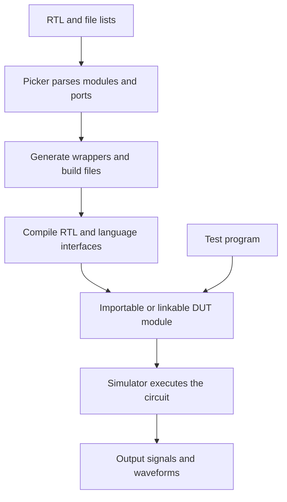

# How generation and simulation work

During export, Picker reads RTL modules and ports and generates an interface for the selected language. The simulator executes the circuit. They are compiled into a DUT module that the test program uses to access the design.

## Why export and compile first

RTL defines the circuit structure. Export options select the language, simulator, and debugging features. Picker uses this information to generate wrappers and build files, which the compiler combines into a model. Tests can then create models and run different inputs, reusing the compiled result.

Changes to RTL, ports, or export options require another export and build. Changes to Python inputs, assertions, or test organization can run immediately.

## What happens during Step

The test stores pending input values in port objects. When it calls `Step()`, inputs are submitted to the simulator, and registered clock pins change as simulation advances. The simulator evaluates the circuit and refreshes output values in the language interface. The test can then read and compare them.

For sequential circuits, `InitClock()` selects the clock port and `Step(n)` advances complete clock cycles. Combinational circuits can also use `Step()` to update outputs after an input change. To keep the cycle count unchanged, submit the inputs and call `RefreshComb()` as shown in [driving a simulation](../guides/simulation.md).

## Why waveforms and internal signals need export options

Waveform recording and internal signal access require additional information at compilation time. `-w` generates waveform recording support; `--vpi` retains signal information for runtime lookup. Ordinary builds can carry less debugging data, while debug builds expose more of the design.

At runtime, `SetWaveform()` selects the output file and `GetInternalSignal()` looks up retained signals. These methods use the features configured during export.

## How a test uses different simulators

The generated DUT wrapper provides common signal access and stepping methods. Simulator templates call the corresponding execution interfaces. You can usually keep the test body, change `--sim`, and rebuild the model.

Waveform formats, checkpoints, and coverage are supplied by the simulator. See [simulator and language support](../reference/compatibility.md) for availability. To change these implementations, start with the [source map in the development guide](../development/contributing.md).
