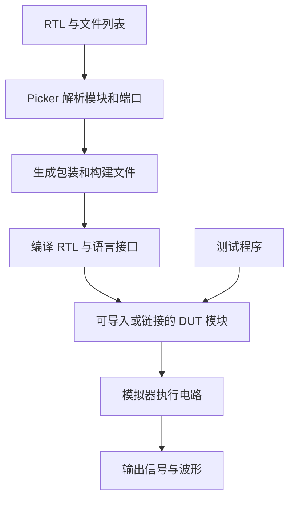

# 生成与运行原理

Picker 在导出时读取 RTL 的模块和端口，为选定的语言生成调用接口。模拟器负责执行电路逻辑。两者编译成一个 DUT 模块，测试程序随后通过这个模块访问电路。

## 为什么要先导出和编译

RTL 决定电路结构，导出选项决定语言、模拟器和调试功能。Picker 根据这些信息生成包装代码和构建文件，编译器再将它们组合起来。完成后，测试程序可以反复创建模型、运行不同输入，多个测试也可以复用同一份编译结果。

修改 RTL、端口或导出选项后，需要重新导出和编译。只修改 Python 测试中的输入、断言或测试组织方式，可以直接重新运行测试。

## 一次 Step 发生了什么

测试代码通过端口对象保存待写入的输入。调用 `Step()` 时，输入被提交给模拟器；已登记的时钟引脚随仿真步骤更新。模拟器计算电路状态后，输出信号刷新到语言接口，测试代码便可以读取和比较结果。

时序电路通过 `InitClock()` 指定时钟端口，`Step(n)` 推进完整的时钟周期。组合电路也可以用 `Step()` 完成输入到输出的一次更新。需要保持当前周期计数时，可以提交输入后调用 `RefreshComb()`，具体写法见[驱动仿真](../guides/simulation.md)。

## 为什么波形和内部信号需要导出选项

波形记录和内部信号访问需要模拟器在编译时保留额外信息。启用 `-w` 会生成记录波形所需的代码；启用 `--vpi` 会保留供运行时查询的信号信息。这样，普通仿真可以使用较少的调试数据，调试构建则可以观察更多细节。

运行时的 `SetWaveform()` 选择输出文件，`GetInternalSignal()` 查找已保留的信号。这些方法使用导出时配置好的功能。

## 同一份测试如何使用不同模拟器

生成的 DUT 包装提供一致的信号和推进方法，各模拟器模板负责调用对应的执行接口。测试主体通常可以保留，导出时更换 `--sim` 后重新编译即可。

波形格式、检查点和覆盖率由模拟器提供，支持情况见[模拟器与语言支持](../reference/compatibility.md)。修改这部分实现时，可以从[开发指南中的源码目录](../development/contributing.md)开始。
